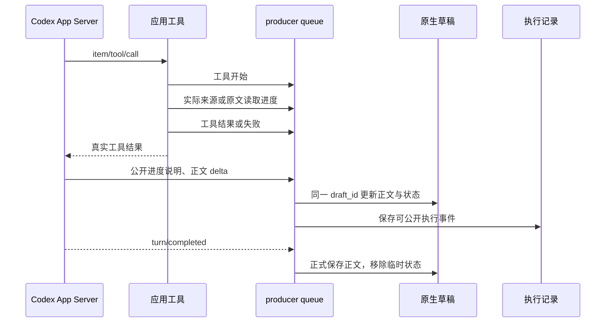

# 输出、执行状态与媒体能力

## 一篇资讯，一个阅读入口

agent 取得候选条目后选择内容、读取原文、写出有依据的中文解读，再提交一篇。程序保存条目与取材状态，立即发送原生消息，附速读、深入解读、技术视角、继续追问、收藏与兴趣反馈按钮。按钮绑定真实条目 ID；追问进入用户当前持久会话，回复资讯消息也可选择该条目。采集记录通过消息中的 `/trace 编号` 查看。

正文使用 Telegram Rich Markdown，自然段落为主。标题、引用、表格、代码块与链接由内容需要决定，不强制固定栏目或固定编号。agent 不生成按钮，应用负责交互控件与最终消息保存。

较长解读必须按语义分组并使用内容明确的小标题，避免连续长段落。并列场景与条件用短列表，关键结论适量加粗，证据限制可使用引用块；命令放在围栏代码块内，较长流程用 `text` 代码块中的竖向箭头或有序步骤列表。普通换行可能被渲染器合并，不能把它当作流程布局。结构跟随内容，不规定统一栏目数量。

完整资讯包括相关背景与深入解读，后部提供有意义的延伸思考及来源依据；工具说明具体任务的输入、操作与输出。事实引用来自实际读取的资料，扩展推论明确区别于已验证结果。

## 原生渲染能力与使用方式

正文继续通过 `rich_message.markdown` 原样发送；Rich Markdown 可混用受支持的 HTML 标签，无需切换到旧 `parse_mode=HTML` 或网页转换。

| 结构 | 适合的内容 |
| --- | --- |
| 标题、列表、引用、代码、高亮 | 阅读路标、并列场景、短引文、命令与核心结论 |
| Markdown 窄表 | 有来源依据的比较，避免宽表和编造数值 |
| 脚注 `[^source1]` 与文末定义 | 对应论点和真实已读来源；转述不冒充原文 |
| `$...$` 或块公式 | 解释实际涉及的计算，避免装饰性公式 |
| `<details><summary>标题</summary>` | 单层补充解释；核心背景与结论保留在外部 |
| 独立图片块 | 来源中已知的公开图片 URL，附图意说明 |

折叠正文可以包含 Markdown，例如：

```markdown
<details><summary>展开查看额外的术语解释</summary>

### 补充概念

- **术语**：解释它在当前文章中的作用。

</details>
```

使用 `open` 属性可默认展开。HTML 模式支持指定的语义标签，不是任意网页渲染；没有通用 CSS、JavaScript、iframe 或内置交互图表。折叠此前有客户端退出报告，原因未定位；本轮按用户要求允许使用，传输测试不能替代手机、桌面与网页客户端验收。

参考：[Telegram 官方富文本格式](https://core.telegram.org/bots/api#rich-message-formatting-options)。不设编辑字数目标，但单条原生消息仍受官方协议上限约束（32,768 字符、500 个块等）。

## 可观察的执行状态



应用使用实际工具调用开始/结果及 App Server 的公开 commentary、计划、上下文压缩事件；不把固定动画当作进度。状态每次发送遵守草稿限流，变化可以合并显示。原始推理、原始工具参数和凭据不发送或保存。公开进度说明反映模型声称的下一步，只有真实工具事件表示操作已执行。

后台定时采集不占用正在交互的聊天草稿；其工具事件保存到任务记录，`/status` 可查看最新任务，`/trace` 查看来源失败与实际操作。草稿中看到的实时状态用于用户主动发起的阅读、分析或报告任务。

## 报告与多模态

| 内容 | 当前支持 |
| --- | --- |
| 长报告 | 保存完整 Markdown 到 SQLite，可继续修订和分页阅读 |
| 可下载报告 | 用户要求时通过 sendDocument 发送 UTF-8 `.md` 文件，或 `/export 编号` |
| 来源图片链接 | 原生协议支持独立媒体块；只能引用用户或真实来源提供的公开媒体 URL，不猜 URL |
| 图表与 Mermaid | Markdown 可保存真实数据表、媒体链接及 Mermaid 源码；没有内置图表渲染工具 |
| 上传图片、PDF、音视频 | 尚未接入理解或提取内容；机器人明确提示当前范围 |
| 新图像、PDF、Word | 尚无生成/导出工具，不能声称已经制作 |

制作报告时先读实际来源、核对数据、区分来源事实与分析，再保存；用户要求文件时导出。文件交付是报告附件，消息正文仍使用原生富文本。若未来加入 PDF/Word、图表渲染或图片分析，应增加相应工具、文件归属与格式校验，并验证真实文件可打开后才标记为支持。

协议依据：[Codex App Server 事件与动态工具](https://learn.chatgpt.com/docs/app-server)、[Telegram 原生流式草稿](https://core.telegram.org/bots/api#sendrichmessagedraft)、[Telegram 文档发送](https://core.telegram.org/bots/api#senddocument)。
