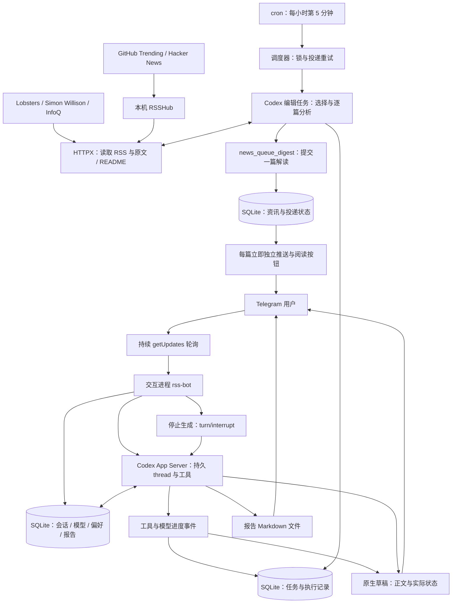

# 个人资讯助手

Python + uv + HTTPX + SQLite + Codex App Server，Telegram 只使用原生富文本。

## 架构与运行状态

新版已于 2026-09-30 部署到 `/root/rss-pipeline`，现有 Telegram 机器人使用 uv 启动的 Codex 后端；开发目录为 `/root/rss-native-preview`。线上 cron 和部署模板均为每小时第 5 分钟采集一次。Telegram 对话由独立 bot 持续轮询，不需要等待下一次定时采集。



采集使用独立临时 Codex thread，由 agent 调用取源、读原文、读取偏好与提交解读工具，默认每次最多六篇，不强求凑数。每提交一篇立即尝试发送，失败通过投递状态重试，不等到所有文章完成再发。用户追问、报告与分析使用当前会话的持久 thread。两类任务都使用本机 Codex 登录状态。

资讯来源包括 Hacker News、Lobsters（技术社区）、Simon Willison（AI 实践）和 InfoQ（工程报道）；GitHub Trending 配置保留，已有来源故障本次不处理。新增三个来源直接读取官方 RSS / Atom，不经过 RSSHub。每个新增来源取最多六条候选，所有来源合计每轮最多推送六篇；相同文章 URL（忽略片段）去重，模型再优先选择同一事件中信息更充分的报道。同一事件的不同 URL 由模型筛选，不保证自动语义去重。

`news_refresh` 可使用 `source=all` 或单独指定 `hackernews` / `github` / `lobsters` / `simonwillison` / `infoq`。旧会话若仍保留旧工具目录，使用 `all` 也能读取新增来源，无需重建会话。公开来源连通性检查：`uv run python scripts/feed_probe.py`，不调用 Codex、不写数据库、不发送 Telegram 消息。

原生 Telegram 流式样例已由用户验收，真实 Codex 摘要、工具与重启恢复已验证。部署时使用正式目录、实际用户会话与项目 skill，已生成并发送原生流式使用说明；服务已开始轮询。用户从 Telegram 实际发起的连续对话与各按钮仍需客户端验收。GitHub Trending 的 RSSHub 503 尚未修复。

## 开发

```bash
uv sync
uv run pytest
uv run python scripts/check_codex_protocol.py
```

运行入口：

```bash
uv run rss-bot
uv run rss-pipeline
```

`rss-bot` 接收 Telegram 操作，`rss-pipeline` 采集并发送新资讯。每个 bot 只能运行一个 getUpdates 消费者；开发期间不要与线上机器人使用同一 Token 同时启动。

配置从项目 `.env` 加载，也可用 `RSS_ENV_PATH` 指向已存在的配置文件；开发/测试使用 `RSS_DB_PATH` 指向独立数据库。不要把凭据复制进 Git。Codex 使用已有 CLI 登录状态；未登录时运行 `codex login`。无需复制认证文件或把 OAuth Token 写进应用配置。

本机已实测 ChatGPT 登录：摘要、报告与交互复用订阅的 Codex 额度，和其他 Codex 使用共享限额，并非无限使用。若切换为 API Key 登录，则采用独立 API 计费。部署时确认 `codex login status`；不要把认证方式的变更当作无成本操作。官方说明：[认证](https://learn.chatgpt.com/docs/auth)、[额度与定价](https://learn.chatgpt.com/docs/pricing)。

## 在 Telegram 使用

| 入口 | 功能 |
| --- | --- |
| 新闻下的速读、深入解读、技术视角 | 读取原文，按模式继续当前会话 |
| 继续追问 | 选择这篇资讯，然后直接发送问题 |
| `/new 名称` | 新建并切换会话，旧会话保留 |
| `/sessions`、`/switch 编号` | 查看并恢复已有会话 |
| `/models`、`/model 模型名` | 切换当前会话的后续模型，保留上下文 |
| `/preferences` | 查看长期偏好 |
| `/prefer 名称=内容` | 保存偏好；空内容删除 |
| `/saved`、`/latest` | 收藏与最近资讯 |
| `/reports`、`/report 编号` | 持久报告与分页阅读 |
| `/export 编号` | 下载 Markdown 报告文件 |
| `/status`、`/trace 编号` | 查看实际任务状态与执行记录 |
| `/delivery` | 推送状态与异常状态计数 |
| `/stop` | 中断 Codex 生成 |
| `/reset` | 新建会话，不删除旧会话 |

可直接说：“记住我关注 Rust 项目的实现机制”“把这篇文章写成一份详细报告并保存”“根据我的自托管场景分析它的局限”。报告与偏好工具绑定当前用户，不能跨用户访问。

会话在数据库中保存 Codex thread_id。服务重启后使用 `thread/resume` 恢复，不把最近几条聊天拼接冒充长期会话；模型上下文仍可能压缩。长期偏好独立保存，切换到新会话后仍提供给模型。

`/models` 来源是 Codex 目录，不能保证每个条目都对当前账号开放。生成失败会保留原会话，让用户重新选择或重试。

## 内容与发送

新资讯尽量取原文/README，再生成自然中文解读。资料不足时使用 RSS 简介并明确限制，禁止补造事实。标题和段落原生渲染，新闻下面提供阅读操作。默认没有嵌入式折叠详情，以便排查用户此前报告的客户端退出问题；这个退出原因尚未确认。

编辑以可读性为第一标准，不设字数或段数目标：先讲文章主要内容，补足核心背景，在叙述中解释必要术语，用具体机制或例子解读亮点；GitHub 工具结合使用场景介绍用途、工作方式和使用入口。标题、加粗、比较表和简洁箭头示意按需使用，不固定栏目。定时编辑读过候选文章后可补读相关公开文档，补充资料不能作为额外资讯提交。详见 [EDITORIAL_POLICY.md](EDITORIAL_POLICY.md)。

原生草稿通过同一个 draft_id 更新，结束后发送原生正式消息。没有普通消息、普通草稿或旧 HTML 转换回退。限流按 Telegram retry_after 处理；最终发送超时标为 unknown，不盲目重发。明确拒绝的发送标为 failed，下次采集重试。

聊天任务的 App Server 事件经过 producer queue 实时更新草稿中的 `<tg-thinking>` 状态：实际工具开始、来源获取结果、原文读取、工具失败、模型的公开进度说明及正文生成。临时状态不写进最终正文；不展示原始 reasoning 或工具参数。`/status`、`/trace` 用数据库中的真实执行记录，按用户隔离。定时采集记录后台事件，并在每篇消息附取材记录入口；它不自动抢占用户正在阅读的对话草稿。

输出与媒体支持见 [OUTPUT_FORMATS.md](OUTPUT_FORMATS.md)。新建会话获得最新工具目录；旧会话继续原 thread，新增导出工具未进入旧目录时可直接用 `/export`，不为了升级工具偷偷重建会话。

首次迁移不会自动补发旧版本未确认的历史条目，避免突然收到大量旧新闻。取材、模型生成和消息消费分开运行，停止按钮连接 Codex turn/interrupt。切换会话/模型前必须等待当前任务停止。

## 指令与 skill

- [AGENTS.md](AGENTS.md)：技术、uv、pytest、原生富文本、会话与错误处理约定。
- [.agents/skills/news-assistant/SKILL.md](.agents/skills/news-assistant/SKILL.md)：助手功能发现、操作入口和工具使用。
- 新线程 cwd 使用项目根目录；App Server 的 instructionSources 用来验证 AGENTS.md 加载。
- 每轮显式传入项目 skill item，不依赖模型碰巧发现该文件。
- 应用工具用于读资讯、保存偏好和报告。运行时关闭 shell、继承的插件/应用及多智能体能力，使用只读沙箱；开发 Codex 与阅读助手职责不同。

## 当前范围

- 收藏与兴趣反馈已持久保存，兴趣反馈作为后续分析的参考；定时 agent 根据显式偏好选择文章，尚无可配置的自动排序规则或订阅时间设置。
- 报告可保存、读取、继续修订和下载 Markdown；尚无 PDF/Word 导出。
- 报告内容页以原生 HTML 转义文本呈现，确保分页不截断结构导致内容丢失。
- 原生消息发送成功不等于所有 Telegram 客户端显示无问题；客户端验收要单独记录。
- `/cc` 旧命令未迁入此版，资讯对话统一交给 Codex；不是把任意服务器执行权限开放给 Telegram。

## 部署

部署前备份数据库，并确保旧 bot 已停止。使用 `deploy/rss-bot.service` 的 uv 入口，cron 使用 `deploy/rss-pipeline.cron`。安装服务或修改 cron 是单独的部署动作，开发 worktree 不自动改变线上服务。

本次开发与验证见 [VALIDATION.md](VALIDATION.md)。

## GitHub Trending 配置

当前链路是 GitHub Trending 网页 → RSSHub → 资讯编辑。RSSHub 获取热榜后调用 GitHub GraphQL 查询公开仓库资料，需要有效的 `GITHUB_ACCESS_TOKEN`，不是配置一个新的 Trending API 地址。官方路由实现见 [RSSHub trending.tsx](https://github.com/DIYgod/RSSHub/blob/master/lib/routes/github/trending.tsx)。

本机 `/root/rsshub/docker-compose.yml` 已从同目录 `.env` 注入该变量。2026-10-09 只读检查：`/github/trending/daily/any` 返回 503，错误页记录 GitHub GraphQL `401 Unauthorized`；未修改令牌，来源尚未恢复。

生成可用于此路由的 GitHub PAT，例如在 Settings → Developer settings → Personal access tokens → Tokens (classic) 创建专用 token，按 [GitHub GraphQL 认证说明](https://docs.github.com/en/graphql/guides/forming-calls-with-graphql) 为公开仓库选择 `public_repo`，设置有效期。在服务器编辑 `/root/rsshub/.env` 中的 `GITHUB_ACCESS_TOKEN`，不要把真实 token 放进聊天、文档或 Git。

更新该文件后重新创建 RSSHub 容器，使新环境变量生效（只重启容器不会重新加载 Compose 的 `.env`）：

```bash
cd /root/rsshub
docker compose up -d --force-recreate rsshub
```

订阅路由已配置为 `/github/trending/daily/any`；`daily` 可改为 `weekly` / `monthly`，`any` 表示不限编程语言，也可改为 `python` / `rust` / `typescript` 等。公开取源检查可运行 `uv run python scripts/feed_probe.py`（工作目录 `/root/rss-pipeline`），不调用模型、不写数据库、不发送消息。需要检查 HTTP 200 和有效 RSS 条目，不能只凭容器启动判断来源恢复。
