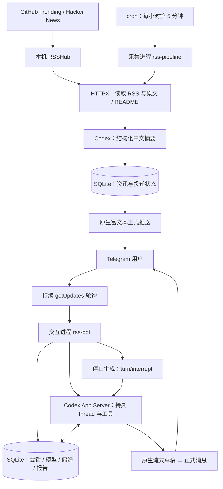

# 个人资讯助手

Python + uv + HTTPX + SQLite + Codex App Server，Telegram 只使用原生富文本。

## 架构与运行状态

新版已完成代码接入与分项验证，开发目录为 `/root/rss-native-preview`；尚未替换线上 `/root/rss-pipeline` 的旧服务。线上现有 cron 和新版部署模板均为每小时第 5 分钟采集一次。Telegram 对话由独立 bot 持续轮询，不需要等待下一次定时采集。



采集摘要使用独立临时 Codex thread；用户追问、报告与分析使用当前会话的持久 thread。会话编号、偏好和报告保存在 SQLite，Codex 管理模型上下文。两类模型任务都使用本机 Codex 登录状态。

原生 Telegram 流式样例已由用户验收，真实 Codex 摘要、工具与重启恢复已验证；完整新版 Telegram → Codex → Telegram 连续对话尚待部署后验收。GitHub Trending 的 RSSHub 503 尚未修复。

## 开发

```bash
uv sync
uv run pytest
uv run python scripts/check_codex_protocol.py
```

运行入口：

```bash
uv run rss-bot
uv run rss-pipeline
```

`rss-bot` 接收 Telegram 操作，`rss-pipeline` 采集并发送新资讯。每个 bot 只能运行一个 getUpdates 消费者；开发期间不要与线上机器人使用同一 Token 同时启动。

配置从项目 `.env` 加载，也可用 `RSS_ENV_PATH` 指向已存在的配置文件；开发/测试使用 `RSS_DB_PATH` 指向独立数据库。不要把凭据复制进 Git。Codex 使用已有 CLI 登录状态；未登录时运行 `codex login`。无需复制认证文件或把 OAuth Token 写进应用配置。

本机已实测 ChatGPT 登录：摘要、报告与交互复用订阅的 Codex 额度，和其他 Codex 使用共享限额，并非无限使用。若切换为 API Key 登录，则采用独立 API 计费。部署时确认 `codex login status`；不要把认证方式的变更当作无成本操作。官方说明：[认证](https://learn.chatgpt.com/docs/auth)、[额度与定价](https://learn.chatgpt.com/docs/pricing)。

## 在 Telegram 使用

| 入口 | 功能 |
| --- | --- |
| 新闻下的速读、深入解读、技术视角 | 读取原文，按模式继续当前会话 |
| 继续追问 | 选择这篇资讯，然后直接发送问题 |
| `/new 名称` | 新建并切换会话，旧会话保留 |
| `/sessions`、`/switch 编号` | 查看并恢复已有会话 |
| `/models`、`/model 模型名` | 切换当前会话的后续模型，保留上下文 |
| `/preferences` | 查看长期偏好 |
| `/prefer 名称=内容` | 保存偏好；空内容删除 |
| `/saved`、`/latest` | 收藏与最近资讯 |
| `/reports`、`/report 编号` | 持久报告与分页阅读 |
| `/delivery` | 推送状态与异常状态计数 |
| `/stop` | 中断 Codex 生成 |
| `/reset` | 新建会话，不删除旧会话 |

可直接说：“记住我关注 Rust 项目的实现机制”“把这篇文章写成一份详细报告并保存”“根据我的自托管场景分析它的局限”。报告与偏好工具绑定当前用户，不能跨用户访问。

会话在数据库中保存 Codex thread_id。服务重启后使用 `thread/resume` 恢复，不把最近几条聊天拼接冒充长期会话；模型上下文仍可能压缩。长期偏好独立保存，切换到新会话后仍提供给模型。

`/models` 来源是 Codex 目录，不能保证每个条目都对当前账号开放。生成失败会保留原会话，让用户重新选择或重试。

## 内容与发送

新资讯尽量取原文/README，再生成自然中文解读。资料不足时使用 RSS 简介并明确限制，禁止补造事实。标题和段落原生渲染，新闻下面提供阅读操作。默认没有嵌入式折叠详情，以便排查用户此前报告的客户端退出问题；这个退出原因尚未确认。

原生草稿通过同一个 draft_id 更新，结束后发送原生正式消息。没有普通消息、普通草稿或旧 HTML 转换回退。限流按 Telegram retry_after 处理；最终发送超时标为 unknown，不盲目重发。明确拒绝的发送标为 failed，下次采集重试。

首次迁移不会自动补发旧版本未确认的历史条目，避免突然收到大量旧新闻。取材、模型生成和消息消费分开运行，停止按钮连接 Codex turn/interrupt。切换会话/模型前必须等待当前任务停止。

## 指令与 skill

- [AGENTS.md](AGENTS.md)：技术、uv、pytest、原生富文本、会话与错误处理约定。
- [.agents/skills/news-assistant/SKILL.md](.agents/skills/news-assistant/SKILL.md)：助手功能发现、操作入口和工具使用。
- 新线程 cwd 使用项目根目录；App Server 的 instructionSources 用来验证 AGENTS.md 加载。
- 每轮显式传入项目 skill item，不依赖模型碰巧发现该文件。
- 应用工具用于读资讯、保存偏好和报告。运行时关闭 shell、继承的插件/应用及多智能体能力，使用只读沙箱；开发 Codex 与阅读助手职责不同。

## 当前范围

- 收藏与兴趣反馈已持久保存，兴趣反馈作为后续分析的参考；自动个性化排序和订阅时间设置属于后续版本。
- 报告可保存、读取和继续修订；当前按原生消息分页查看，尚无 PDF 导出。
- 报告内容页以原生 HTML 转义文本呈现，确保分页不截断结构导致内容丢失。
- 原生消息发送成功不等于所有 Telegram 客户端显示无问题；客户端验收要单独记录。
- `/cc` 旧命令未迁入此版，资讯对话统一交给 Codex；不是把任意服务器执行权限开放给 Telegram。

## 部署

部署前备份数据库，并确保旧 bot 已停止。使用 `deploy/rss-bot.service` 的 uv 入口，cron 使用 `deploy/rss-pipeline.cron`。安装服务或修改 cron 是单独的部署动作，开发 worktree 不自动改变线上服务。

本次开发与验证见 [VALIDATION.md](VALIDATION.md)。
